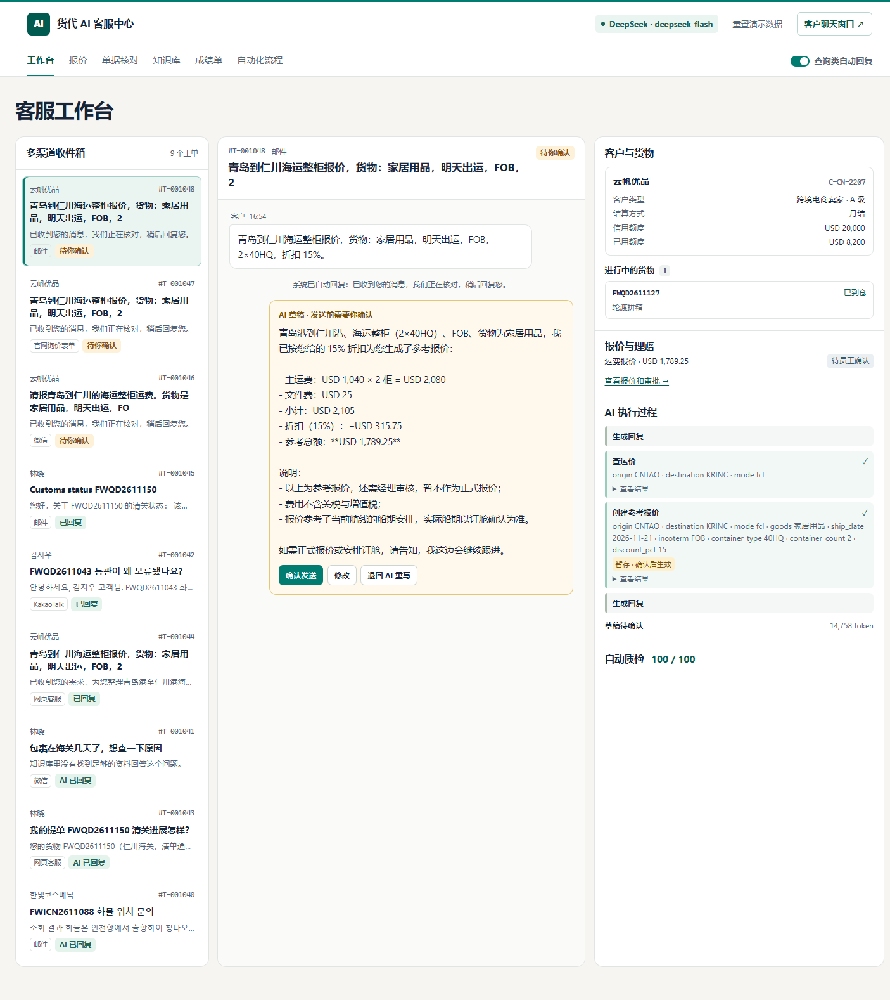
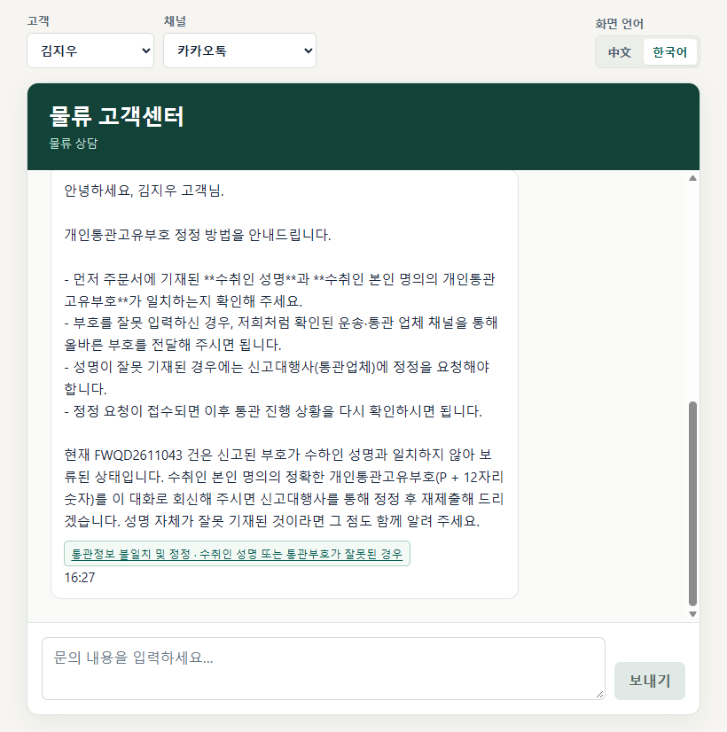
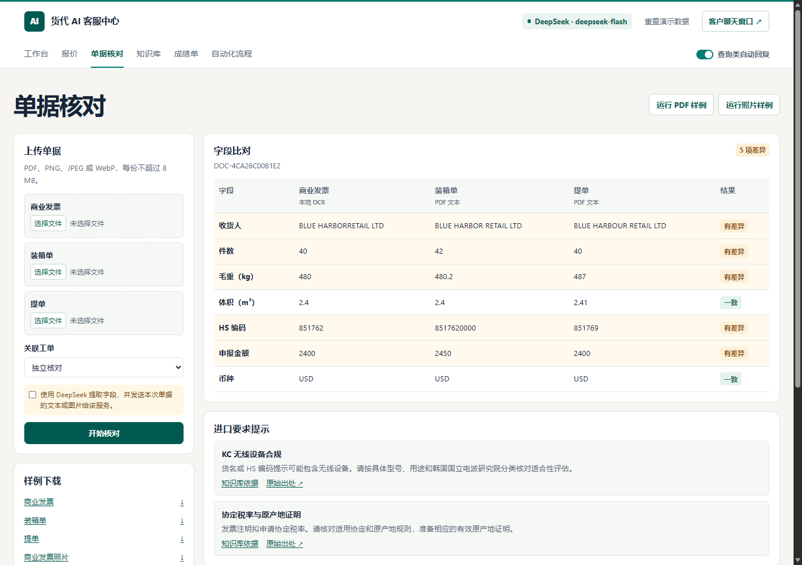
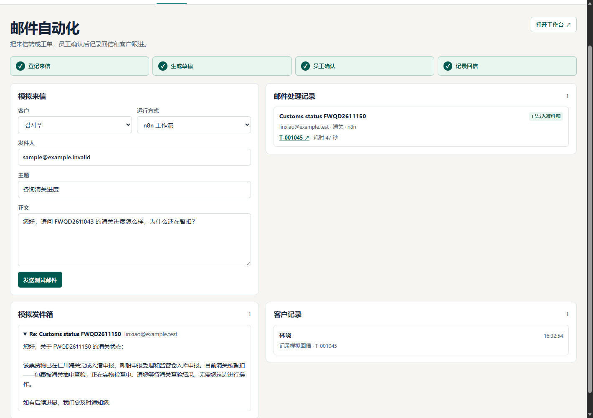
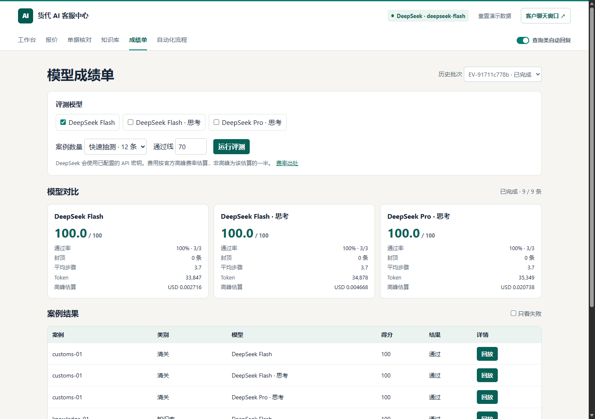
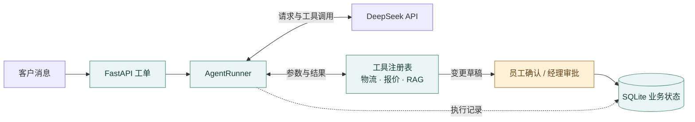

<h1 align="center">Freight Ops Copilot</h1>

<p align="center"><strong>中韩跨境物流 AI 工作台</strong></p>

<p align="center">处理客户询价、查清关进度、核对单据，遇到需要确认的业务动作就交给员工。</p>

<p align="center">
  <a href="#一笔询价怎样变成正式报价">看报价演示</a>
  · <a href="#从四张截图看工作台">看功能截图</a>
  · <a href="#在本机运行">运行项目</a>
  · <a href="docs/作品说明.md">阅读作品说明</a>
</p>

---

## 一笔询价怎样变成正式报价

> 青岛到仁川，家居用品，两个 40HQ 柜，FOB。可以给 15% 折扣吗？

| 客户发起询价 | AI 查费率与船期 | 员工核对草稿 | 经理审批 |
| --- | --- | --- | --- |
| 青岛 → 仁川，海运整柜 | 主运费 USD 2,080，文件费 USD 25 | 折后 **USD 1,789.25**，可修改或确认 | 批准后下载正式报价 PDF |

<p align="center">
  <a href="docs/assets/demo/09-quote-chat-draft.png">
    
  </a>
</p>

<p align="center"><sub>点击查看完整原图。中间是员工待确认的草稿，右侧是报价状态、工具执行过程和自动质检。</sub></p>

[查看经理审批](docs/assets/demo/10-quote-manager.png) · [查看正式报价和 PDF 入口](docs/assets/demo/11-quote-formal.png)

## 从四张截图看工作台

<table>
  <tr>
    <td width="50%" valign="top">
      <strong>01 · 清关问题用韩语回答</strong><br>
      客户询问通关号码怎样更正，回复附有韩文知识库出处。<br><br>
      <a href="docs/assets/demo/01-korean-chat-cited.png"></a><br>
      <a href="docs/assets/demo/03-knowledge-source.png">查看原文章节</a>
    </td>
    <td width="50%" valign="top">
      <strong>02 · 三份单据放在一起核对</strong><br>
      对照商业发票、装箱单和提单，查看五项差异及每个字段的提取来源。<br><br>
      <a href="docs/assets/demo/07-document-photo-ocr.png"></a><br>
      <a href="docs/assets/demo/08-document-drafts.png">查看合规提示和更正草稿</a>
    </td>
  </tr>
  <tr>
    <td width="50%" valign="top">
      <strong>03 · 测试邮件等员工确认</strong><br>
      n8n 收到测试来信后创建工单，员工确认才生成模拟回信和客户记录。<br><br>
      <a href="docs/assets/demo/15-mail-completed.png"></a><br>
      <a href="docs/assets/demo/14-mail-pending.png">查看确认前的状态</a>
    </td>
    <td width="50%" valign="top">
      <strong>04 · 同一案例比较三个模型配置</strong><br>
      查看 Flash、Flash 思考和 Pro 思考的通过率、用量，再打开单例回放。<br><br>
      <a href="docs/assets/demo/12-scorecard-batch.png"></a><br>
      <a href="docs/assets/demo/13-scorecard-replay.png">查看工具回放</a>
    </td>
  </tr>
</table>

还支持中文货物查询、仓库协作、改派、理赔，以及整柜、拼箱、轮渡、空运报价。[浏览全部 16 张截图与 14 个测试样例](docs/作品说明.md)

## 一条工单在后台怎么走



- **查到的事实有出处。** 工具先校验客户与货物归属。双语 RAG 结合关键词和本地 E5 向量，可以回到知识库原文章节。
- **业务变更有确认。** 查询类可自动回复，资料更正等操作先保存为草稿。超权限折扣由经理审批。
- **AI 做过什么可以回看。** 工作台实时显示工具调用、参数和结果。评测用独立数据跑同一套流程，保留单例回放。

[完整系统架构](docs/figures/harness-architecture.svg) · [工单处理时序](docs/figures/ticket-confirmation.svg)

## 实测结果

| 验收项 | 结果 |
| --- | --- |
| 全业务离线回归 | 80/80，使用确定性测试依赖 |
| DeepSeek API 抽测 | 3 种配置各 3/3，共 9 次。样例覆盖清关、知识库和货物跟踪 |
| 知识库 | 混合检索 15/15，另有 5/5 真实 API 查询抽测 |
| n8n 流程 | 验证了收件、等待、人工确认、回写和重复来信去重 |
| 后端与前端 | 后端 294 项、前端 14 项测试通过，前端生产构建通过 |

[复现演示与评测](docs/demo.md) · [知识库评测命令](backend/evals/README.md)

## 在本机运行

需要 Python 3.10 或以上、Node.js 22.x（至少 22.12）。在仓库根目录复制配置模板。

```powershell
Copy-Item .env.example .env
```

在 `.env` 中填入自己的 `DEEPSEEK_API_KEY`，再启动服务。

```powershell
powershell -ExecutionPolicy Bypass -File .\scripts\start.ps1
```

打开 [员工工作台](http://127.0.0.1:8000/workbench) 或 [客户聊天窗口](http://127.0.0.1:8000/chat)。第一次启动会安装依赖并构建前端。可加 `-Port 8010` 更换端口。

想快速体验，可在客户窗口选择 **김지우 / KakaoTalk**，输入 `FWQD2611043 통관이 왜 보류됐나요?`，再追问 `개인통관고유부호를 정정하는 방법은 무엇인가요?`。收到回复后，打开对应工单，查看清关查询、知识库检索及引用出处。

<details>
<summary>本地模型、PDF 字体、自动化与 Docker</summary>

安装依赖后，可下载量化多语言 E5 和 Noto Sans SC/KR 字体，约 163 MB。资产存放于本地 `backend/var`。

```powershell
.\backend\.venv\Scripts\python.exe .\scripts\provision_assets.py --fonts --embeddings
```

重启应用后启用混合检索及对应的 PDF 字体。启动 n8n 需要 Node.js 24，详见 [邮件工作流说明](workflows/README.md)。

仓库提供 [Docker Compose 配置](compose.yaml)，已通过配置语法检查。配置好 `.env` 后，可用以下命令启动。

```sh
docker compose up --build -d
docker compose --profile automation up -d n8n
```

容器运行验证范围见 [作品说明](docs/作品说明.md#验收记录与运行方式)。

</details>

<details>
<summary>运行本地测试</summary>

```powershell
Push-Location backend
.\.venv\Scripts\python.exe -m pytest -q
Pop-Location
npm --prefix frontend test
npm --prefix frontend run build
```

</details>

## 技术栈与项目来源

React、TypeScript、FastAPI、SQLite、SSE、DeepSeek、ONNX Runtime、RapidOCR、ReportLab、n8n。

作者孙山珉。项目借鉴 Industrial Post-Training Training Release 的隔离写入和评测流水线设计，货代场景代码与演示数据由本项目独立维护。
