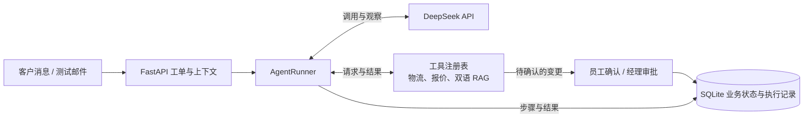

# Freight Ops Copilot

**中韩跨境物流 AI 工作台** · 从客户询价与清关查询，到人工审批与业务记录。

在同一个工作台里，客服可以核对提单状态、打开知识库出处、审查报价草稿，并查看 AI 调用了哪些工具。清关资料更正、报价折扣和邮件回复都有对应的人工确认环节。

[作品说明与 16 张截图](docs/作品说明.md) · [系统架构大图](docs/figures/harness-architecture.svg) · [演示与复测脚本](docs/demo.md)

## 从客户询价到正式报价

客户询问青岛至仁川整柜运费，指定 `2×40HQ`、FOB，并申请 15% 折扣。DeepSeek 查询业务费率，报价模块算出 **USD 1,789.25**。员工可以检查费用明细、船期和工具结果，确认后转经理审批。审批通过即可下载正式 PDF。

[](docs/assets/demo/09-quote-chat-draft.png)

## 能做什么

| 场景 | 可体验的流程 |
| --- | --- |
| 中韩客服与清关 | 查询货物、仓库和清关状态。更正个人通关资料时，员工确认后提交业务变更。 |
| 双语知识库 | 中韩文检索通过 BM25 和本地 E5 向量排序，回复可定位到原文章节。找不到足够资料时说明证据缺口。 |
| 报价与审批 | 按海运整柜、拼箱、轮渡、空运的计费规则试算。低毛利或超权限折扣进入经理审批。 |
| 单据核对 | 读取商业发票、装箱单和提单。PDF 文本和照片 OCR 的字段来源可追溯，并按差异生成处理草稿。 |
| 邮件自动化 | n8n 接收测试来信并创建工单，等待员工确认后写入模拟发件箱和客户跟进记录，按 Message-ID 去重。 |
| 模型评测 | 同一组案例比较 DeepSeek Flash、Flash 思考和 Pro 思考。成绩单记录评分、用量和逐例工具回放。 |

## Agent Harness 如何工作



- **业务事实有出处。** 工具校验参数和归属，读取结构化业务数据。RAG 答复可以回到具体原文章节。
- **写入有确认。** 查询类可自动回复。敏感变更先保存为草稿，员工确认后生效。
- **每次执行可回放。** 工作台通过 SSE 更新工单和工具时间线。评测用独立数据重跑同一执行链路，逐例核对回复、工具和状态。

更多模块、状态与事件流见 [完整 Harness 架构](docs/作品说明.md#系统-harness-架构)。

## 验收结果

| 检查 | 结果 |
| --- | --- |
| 后端与前端 | 294 项后端测试、14 项前端测试通过，前端生产构建通过 |
| 全业务离线回归 | 80/80，使用确定性测试依赖 |
| DeepSeek API 抽测 | Flash、Flash 思考和 Pro 思考各 3/3，共 9 次 |
| 知识库 | 混合检索 15/15，另有 5/5 真实 DeepSeek 查询抽测 |
| n8n 流程 | 已验证 Webhook、Wait、人工确认、回写及重复来信去重 |

[测试样例与验收明细](docs/作品说明.md#测试样例) · [知识库评测命令](backend/evals/README.md)

## 在本机运行

需要 Python 3.10 或以上、Node.js 22.x（至少 22.12）。在仓库根目录复制配置模板。

```powershell
Copy-Item .env.example .env
```

在 `.env` 中填入自己的 `DEEPSEEK_API_KEY`，再启动服务。

```powershell
powershell -ExecutionPolicy Bypass -File .\scripts\start.ps1
```

打开 [员工工作台](http://127.0.0.1:8000/workbench) 或 [客户聊天窗口](http://127.0.0.1:8000/chat)。第一次启动会安装依赖并构建前端。可加 `-Port 8010` 更换端口。

想快速体验，可在客户窗口选择 **김지우 / KakaoTalk**，输入 `FWQD2611043 통관이 왜 보류됐나요?`，再追问 `개인통관고유부호를 정정하는 방법은 무엇인가요?`。收到回复后，打开对应工单，查看清关查询、知识库检索及引用出处。

<details>
<summary>本地模型、PDF 字体、自动化与 Docker</summary>

安装依赖后，可下载量化多语言 E5 和 Noto Sans SC/KR 字体，约 163 MB。资产存放于本地 `backend/var`。

```powershell
.\backend\.venv\Scripts\python.exe .\scripts\provision_assets.py --fonts --embeddings
```

重启应用后启用混合检索及对应的 PDF 字体。启动 n8n 需要 Node.js 24，详见 [邮件工作流说明](workflows/README.md)。

仓库提供 [Docker Compose 配置](compose.yaml)，已通过配置语法检查。配置好 `.env` 后，可用以下命令启动。

```sh
docker compose up --build -d
docker compose --profile automation up -d n8n
```

容器运行验证范围见 [作品说明](docs/作品说明.md#验收记录与运行方式)。

</details>

<details>
<summary>运行本地测试</summary>

```powershell
Push-Location backend
.\.venv\Scripts\python.exe -m pytest -q
Pop-Location
npm --prefix frontend test
npm --prefix frontend run build
```

</details>

## 技术栈与项目来源

React、TypeScript、FastAPI、SQLite、SSE、DeepSeek、ONNX Runtime、RapidOCR、ReportLab、n8n。

作者孙山珉。项目借鉴 Industrial Post-Training Training Release 的隔离写入和评测流水线设计，货代场景代码与演示数据由本项目独立维护。
